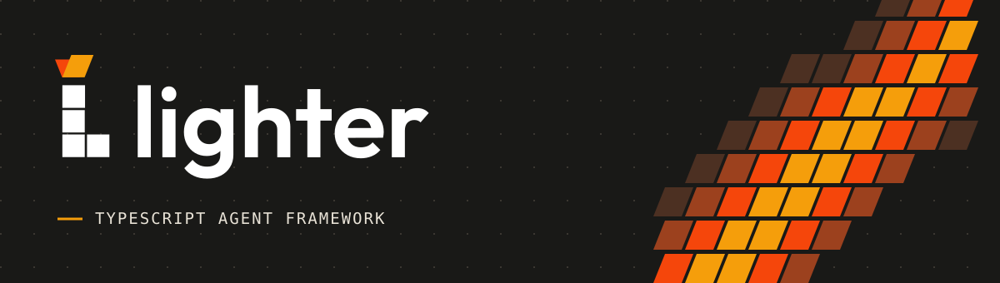
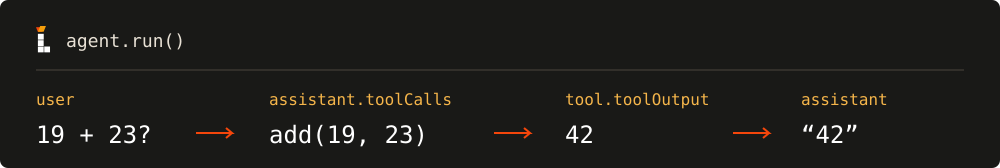

# Lighter



[](https://www.npmjs.com/package/@yong_xie/lighter)

**English** · [简体中文](./README.zh-CN.md)

Lighter is a TypeScript framework for building agents that call your JavaScript functions. Give an agent a model, a message, and any tools it can use. When the model requests a tool, Lighter runs it, feeds the result back, and continues until the model replies without requesting another tool.

## Why Lighter?

- **Lightweight.** The agent loop runs in your Node.js process. Its three direct runtime dependencies are the OpenAI SDK, the Anthropic SDK, and Zod. Your application decides where to store conversations.
- **Simple.** The same agent accepts `run({ messages })` for a complete result and `stream({ messages })` for incremental output. A tool is a named function with a description and a Zod object schema.
- **Reliable.** Lighter validates tool arguments before execution. Invalid arguments and thrown tool errors become messages the model can use to correct its call. If a model stream ends before a complete message arrives, the run reports failure and returns the messages already completed.
- **Customizable.** Choose `OpenAIProvider`, `ClaudeProvider`, or `DeepSeekProvider`, or implement the [Provider interface](./providers/provider.ts) with a name, `invoke`, and `stream`. Set `systemPrompt` with a `SystemMessage`, register your own tools, or use hooks around a run or model call.

## Quick start

Install the package in a Node.js project. It ships as ESM with TypeScript declarations. The examples use Node.js 22.23.3.

```sh
npm install @yong_xie/lighter
```

Set `OPENAI_API_KEY` and `OPENAI_MODEL_ID` in your environment, using a model ID available to your account. Save this as `hello.mjs` and run `node hello.mjs`. This example calls the OpenAI API.

```js
import { Agent, Model, OpenAIProvider, UserMessage } from "@yong_xie/lighter";

const { OPENAI_API_KEY, OPENAI_MODEL_ID } = process.env;
if (!OPENAI_API_KEY || !OPENAI_MODEL_ID) {
  throw new Error("Set OPENAI_API_KEY and OPENAI_MODEL_ID");
}

const model = new Model(new OpenAIProvider(OPENAI_API_KEY, OPENAI_MODEL_ID));
const agent = new Agent({ model });
const history = [new UserMessage("Suggest a name for a bookshop on the moon.")];
const result = await agent.run({ messages: history });

if (result.status === "failed") throw result.error;
history.push(...result.messages);
console.log(result.messages.at(-1)?.content);
```

`result.messages` contains only the messages generated during this run. To continue the conversation, append a new `UserMessage` to `history` and pass it back to `agent.run`.

## Demo · Let the model call a function



Install `zod` with `npm install zod@4`. Add the following to `hello.mjs` to reuse its `model`. The diagram shows one possible exchange with a model that supports tool calls.

```js
import { Tool } from "@yong_xie/lighter";
import * as z from "zod";

const add = new Tool({
  name: "add",
  description: "Return the sum of two numbers.",
  parametersZodSchema: z.strictObject({ a: z.number(), b: z.number() }),
  func: ({ a, b }) => a + b,
});

const calculator = new Agent({ model, tools: [add] });
const answer = await calculator.run({
  messages: [new UserMessage("Use the add tool to calculate 19 + 23.")],
});
if (answer.status === "failed") throw answer.error;
for (const message of answer.messages) {
  if (message.role === "tool") console.log(message.toolName, message.toolOutput);
  if (message.role === "assistant" && message.content) console.log(message.content);
}
```

Lighter executes tool calls in the order the model requested them. Each tool result carries the corresponding call ID, so the model can match results to requests on its next turn.

## Stream a reply

Reuse the `agent` from the quick start. Print text as it arrives and inspect the terminal result for failure.

```js
for await (const event of agent.stream({ messages: [new UserMessage("Hello!")] })) {
  if ("status" in event) {
    if (event.status === "failed") throw event.error;
  } else if (event.type === "text_delta") {
    process.stdout.write(event.text);
  }
}
```

Some models also emit `reasoning_delta` events. To save a streamed conversation, append the terminal result’s `messages` to your history. These include complete assistant messages and tool results.

## Lifecycle hooks

Pass hooks in `new Agent({ model, hooks: { … } })`. Each hook accepts a synchronous or asynchronous callback. Returning a replacement value changes what the next step receives.

| Hook | When it runs | Value it receives |
| --- | --- | --- |
| `BeforeAgentHook` | At the start of a run | Agent request |
| `BeforeModelHook` | Before each model call, including tool follow-ups | Model request with messages and optional tool specs |
| `AfterModelHook` | When a complete model message arrives | Assistant message, including tool calls |
| `AfterAgentHook` | After the loop completes successfully | Messages generated in this run |

## Local development

```sh
pnpm install --frozen-lockfile
npm run check
npm run build
```

`npm run check` type-checks the project and runs the offline tests. The provider tests exercise SDK request encoding, streamed responses, and error handling with mocked HTTP. See the [test guide](./test/README.md) for coverage. To create a local installable archive, run `npm pack`.

Lighter is distributed under the [ISC license](./LICENSE).
