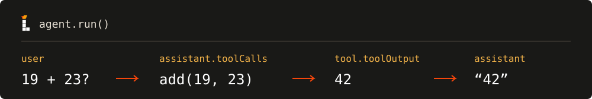

# Lighter


[](https://www.npmjs.com/package/@yong_xie/lighter)

[English](./README.md) · **简体中文**

**一个基于 TypeScript 的轻量 AI agent 开发框架。**

Lighter 维护了一个精简但可靠的核心 loop，提供 Provider、Model、Tool 和 Hook 组件封装，开箱即用，适合快速搭建 AI agent 产品。

Lighter 的设计受到 Pi 的启发，产品核心保持精简，同时保留足够的自定义能力。产品的易用性也被置于优先位置，Lighter 的 API 简单且符合直觉，适合所有水平的开发者使用。

> **状态：** 当前为 alpha 版本，API 可能发生破坏性变化。

## 开始之前

- Node.js 22+
- 模型 provider 的 API key 和模型 ID。

## 第一个 Agent

在已经安装 `@yong_xie/lighter` 的项目里，创建 `hello.ts`：

```ts
import { Agent, Model, OpenAIProvider, UserMessage } from "@yong_xie/lighter";

// 1. 连接模型 provider。
// 把 key 和模型 ID 替换成你自己的。
const provider = new OpenAIProvider("sk-xxxxxxxxxx", "gpt-4.1-mini");

// 2. 把 provider 包装成 model。
const model = new Model(provider);

// 3. 用这个 model 创建 agent。
const agent = new Agent({ model });

const result = await agent.run({
  messages: [new UserMessage("给一家开在月球上的书店起个名字。")],
});

// 打印最后一条消息。
console.log(result.messages.at(-1));
```

运行：

```sh
node hello.ts
```

你应该会看到一条助手消息，其中包含一句简短的回复，例如：

```text
月宫书店
```

这就是一个最小的 Agent 原型。按顺序组合 `Provider`、`Model` 和 `Agent`，就能轻松做出一个可以实际工作的 AI agent。

## 添加工具

工具是可选的。如果你只需要一次模型回复，上面的示例就足够了。

工具是允许模型调用的函数。你只需要定义好工具，之后交给 Lighter 就好。

为了规范函数的参数格式，我们需要安装 Zod：

```sh
npm install zod@4
```

创建一个新的 `tool.ts`，完整代码如下：

```ts
import { Agent, Model, OpenAIProvider, Tool, UserMessage } from "@yong_xie/lighter";
import * as z from "zod";

const provider = new OpenAIProvider("sk-xxxxxxxxxx", "gpt-4.1-mini");
const model = new Model(provider);

// 定义一个工具。
const add = new Tool({
  name: "add",
  description: "返回两个数的和。",
  parametersZodSchema: z.strictObject({ a: z.number(), b: z.number() }),
  func: ({ a, b }) => a + b,
});

// 创建带工具的 agent 并运行。
const agent = new Agent({ model, tools: [add] });
const answer = await agent.run({
  messages: [new UserMessage("请用 add 工具计算 19 + 23。")],
});

console.log(answer.messages);
```

运行：

```sh
node tool.ts
```

你应该会在打印出的数组里看到一条输出为 `42` 的工具消息，以及一条助手回复。输出大致如下：

```text
[
  AssistantMessage { content: '', toolCalls: [ add(19, 23) ] },
  ToolMessage { toolName: 'add', toolOutput: '42', isError: false },
  AssistantMessage { content: '19 + 23 = 42。', toolCalls: [] }
]
```

下图展示了 Lighter 处理工具调用的过程。


## Lighter 的核心概念

目前为止，你已经对 Lighter 如何工作有了初步印象。接下来我们会对 Lighter 的核心概念做一个简单介绍。

### 核心类

`Provider`、`Model`、`Agent` 是让 Agent 运行起来的三个核心类。

| 类         | 它的作用                          |
| ---------- | --------------------------------- |
| `Provider` | 负责和对应的大语言模型 API 沟通。 |
| `Model`    | 封装模型调用。                    |
| `Agent`    | 负责核心循环。                    |

### 组件类

`Message`、`Tool`、`Hook` 是让 Agent 正常工作和扩展能力的组件。

| 组件      | 它的作用                                      |
| --------- | --------------------------------------------- |
| `Message` | 承载和 agent 沟通的各种消息。                 |
| `Tool`    | 完成特定任务，供 agent 调用的函数。             |
| `Hook`    | 生命周期钩子，可以在特定环节影响 agent 运行。 |

一次运行大致是这样：

```text
Agent
  ├─ 调用 Model → Provider → 模型 API
  ├─ 模型请求工具时，执行 Tool
  └─ 重复，直到模型不再请求工具
```

`Agent` 接受 `model`、`tools`、`systemPrompt` 和 `hooks`，其中只有 `model` 是必填的。`systemPrompt` 是一个 `SystemMessage`；省略时，Lighter 使用 `You are a helpful assistant.` 作为默认提示词。

## 高级用法

### 流式输出

用 `stream()` 代替 `run()`，逐步接收并处理模型返回的数据。创建一个 `stream.ts`：

```ts
import { Agent, Model, OpenAIProvider, UserMessage } from "@yong_xie/lighter";

const provider = new OpenAIProvider("sk-xxxxxxxxxx", "gpt-4.1-mini");
const model = new Model(provider);
const agent = new Agent({ model });

const streamEvent = agent.stream({
  messages: [new UserMessage("你好！")]
});

// 获取流式输出并打印
for await (const event of streamEvent) {
  if ("type" in event && event.type === "text_delta") {
    process.stdout.write(event.text);
  }
}
```

运行：

```sh
node stream.ts
```

这个例子只打印 `text_delta`；`reasoning_delta` 和最终结果都会被跳过。

流式输出会依次返回：

- `text_delta`：一段文本；
- `reasoning_delta`：一段推理内容，部分 provider 支持；
- 一个完整的 `AgentResponse`：包含本轮生成消息的完整响应。

根据需要处理对应的消息即可。

### 对话历史

对话历史由你的应用维护和保存。为了保持上下文，每次调用 `agent.run()` 时传入完整的对话历史，并把返回的消息追加进去。下面的示例复用第一个示例中的 `agent`：

```js
const conversationHistory = [new UserMessage("给一家开在月球上的书店起个名字。")];

// 收到 agent 回复并保存到对话历史中
const firstReply = await agent.run({ messages: conversationHistory });
conversationHistory.push(...firstReply.messages);

// 新增用户提问
conversationHistory.push(new UserMessage("再给我三个选项。"));

// 再次收到新的回复并保存
const secondReply = await agent.run({ messages: conversationHistory });
conversationHistory.push(...secondReply.messages);

console.log(secondReply.messages.at(-1)?.content);
```

`firstReply.messages` 和 `secondReply.messages` 都只包含本轮生成的消息，不包含 `conversationHistory` 里已有的内容。`run()` 不会修改你传入的数组，所以需要像示例一样手动 `push`。

要注意，`Agent` 返回结果里的 `messages` 是一个消息数组，不只是模型的最终回答。数组中可能包含：

- 助手消息：最终回答，可能带有 `reasoning` 推理内容；
- 工具消息：工具调用的结果；
- 工具调用后的后续助手消息。

因此不要把 `messages` 当成单个字符串，使用前请按消息角色处理。

每次运行都有独立的消息上下文，所以同一个 `Agent` 可以并发处理多个请求。

### 生命周期钩子

在 `new Agent({ model, hooks: { ... } })` 中传入钩子实例。下面的示例复用第一个示例中的 `model`：

```js
import { BeforeModelHook } from "@yong_xie/lighter";

const logModelRequest = new BeforeModelHook({
  hookName: "log-model-request",
  hookFunction: (request) => {
    console.log(request.messages.length, "messages");
    // 想修改发给模型的请求，就返回一个新的 request。
    // 不返回值时，使用原 request 调用模型。
  },
});

const loggedAgent = new Agent({
  model,
  hooks: { beforeModel: logModelRequest },
});
```

每个钩子都有 `hookName`、可选的 `description`，以及一个可以同步或异步执行的 `hookFunction`。

| 钩子              | 调用时机                                   | 接收的值                  |
| ----------------- | ------------------------------------------ | ------------------------- |
| `BeforeAgentHook` | 每次运行开始时，调用一次                   | `AgentRequest`            |
| `BeforeModelHook` | 每次模型调用前，包括工具返回后的下一次调用 | `ModelRequest`            |
| `AfterModelHook`  | 收到完整的助手消息时                       | `AssistantMessage`        |
| `AfterAgentHook`  | 循环成功结束后                             | 本轮生成的 `BaseMessages` |

返回替换值可以改变请求、消息或结果；不返回值则保持原值。钩子适合用来做日志、脱敏、请求改写或防护。

需要注意的是：替换或修改助手消息可能会丢失后续轮次使用的 provider 特定上下文。例如，OpenAI 的 reasoning item 和 Claude 的 thinking block 只有在消息未被修改时才能重放。如果你只是读取或记录消息，不会有这个问题。

这是当前的限制。

### Provider 选项

`Model` 接受任何实现 `Provider` 接口的对象，Provider 对象需包含：`name`、`invoke` 和 `stream`。`invoke` 返回一条完整的 `AssistantMessage`；`stream` 产生 `reasoning_delta`、`text_delta`，最后产生一条 `message` 事件。

内置适配器位于 [`providers/`](./providers/)：

| Provider           | 模型 API                    | 配置                                                    |
| ------------------ | --------------------------- | ------------------------------------------------------- |
| `OpenAIProvider`   | OpenAI Responses API        | `reasoning`、`maxOutputTokens`；固定发送 `store: false` |
| `ClaudeProvider`   | Anthropic Messages API      | `maxOutputTokens`（默认 8192）、`thinking`              |
| `DeepSeekProvider` | DeepSeek 的 OpenAI 兼容接口 | 构造参数：API key、模型 ID                              |

每个适配器负责把共享消息类型转换成对应 API 的格式，再把响应转换回来，并把 SDK 错误归类为 `ModelError`。OpenAI 和 Claude 还会在消息未被修改时保留 provider 特定上下文，供后续轮次使用。

要接入其他服务，实现 `Provider` 并传给 `new Model(provider)`。接口定义见 [`providers/provider.ts`](./providers/provider.ts)。

## 错误与排查

### 跑不通时

- `ERR_REQUIRE_ESM` 或 `Cannot use import statement`：使用 ESM 模块，并在 `package.json` 中设置 `"type": "module"`。
- `401` 或 `auth_error`：检查代码里填的 API key。
- 模型不存在：检查代码里填的模型 ID。
- 返回结果的 `status` 是 `"failed"`：读取 `error`。

### 错误码

运行失败时，返回结果的 `status` 是 `"failed"`，`error` 保存原因：

```ts
{ status: "failed"; messages: BaseMessages; error: unknown }
```

`error` 的类型是 `unknown`，而且可能为 `undefined`，使用前请先判断。Provider SDK 的错误会被归一化为带 `code` 的 `ModelError`：

| Code              | 含义                       |
| ----------------- | -------------------------- |
| `auth_error`      | 认证或权限失败             |
| `rate_limit`      | 触发 provider 限流         |
| `invalid_request` | 发给 provider 的请求不合法 |
| `network_error`   | 网络连接失败               |
| `server_error`    | Provider 服务端失败        |
| `bad_response`    | 响应不完整、失败或无法解析 |
| `aborted`         | 请求被取消                 |
| `unknown`         | 未分类的失败               |

`ModelError` 还提供 `httpStatus`（HTTP 错误状态码）和 `responseStatus`（如 `failed`、`incomplete` 等生成状态）。

## 边界与安全

Lighter 只负责循环，不包含：

- 对话持久化
- 最大模型轮数
- 超出 provider SDK 的请求取消或超时
- 自己的重试策略
- 追踪、指标或面板
- 工具代码沙箱
- 并行工具执行

如果模型持续请求工具，循环会继续运行；需要的话，请自己加轮数上限。提前停止流式消费可以阻止后续工具执行，但不会取消已经在运行的工具。

工具参数校验只检查格式，不代表权限。工具以你的应用权限运行，模型输出应当视为不可信输入。请在工具内部做权限检查，不要把模型输出直接交给 shell、数据库或文件系统。如果需要隔离，请把工具代码放在单独的进程或服务里运行。

## API 一览

包导出：

- `Agent`、`Model`、`Tool`，以及它们的配置、请求和结果类型
- `SystemMessage`、`UserMessage`、`AssistantMessage`、`ToolMessage` 和 `BaseMessages`
- `BeforeAgentHook`、`AfterAgentHook`、`BeforeModelHook`、`AfterModelHook`
- `Provider`、`OpenAIProvider`、`ClaudeProvider`、`DeepSeekProvider`
- `ModelError` 和 `ModelErrorCode`

源码入口是 [`index.ts`](./index.ts)。类型声明随包发布。

## 本地开发

```sh
pnpm install --frozen-lockfile
pnpm check
pnpm build
pnpm pack --dry-run
```

`pnpm check` 会执行 TypeScript 类型检查和离线测试。测试使用模拟 HTTP，不会访问真实模型 API，也不构成真实兼容性验证。覆盖范围和当前限制见[测试指南](./test/README.md)。

## 许可证

ISC。见 [LICENSE](./LICENSE)。

[GitHub](https://github.com/Mou2xie/lighter) · [Issues](https://github.com/Mou2xie/lighter/issues) · [npm](https://www.npmjs.com/package/@yong_xie/lighter)
